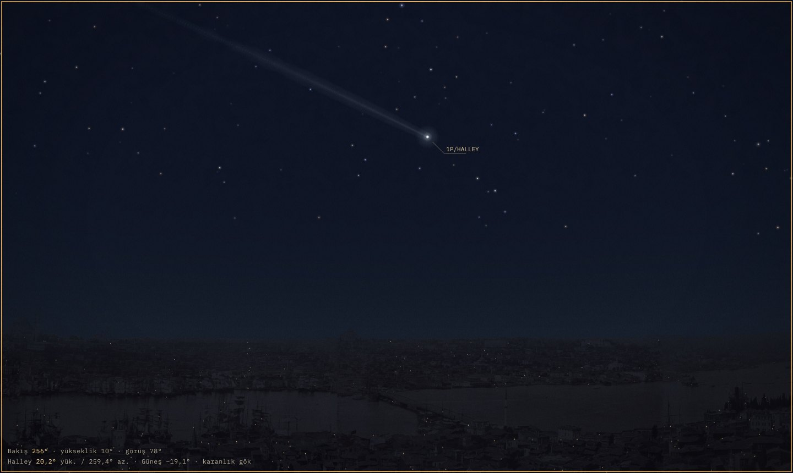

# Halley Geceleri — İstanbul, 1910



1910 baharında İstanbul’da Halley kuyrukluyıldızının gelişini anlatan, tarihsel kaynaklara dayalı, içinde dolaşılabilen sinematik bir web deneyimi. Üç kurmaca insan (Rıza, Münevver, Yusuf; yalnız sesleri duyulur), üç gece (10, 18–19 ve 27 Mayıs), gerçek fotoğraflar (Berggren’in Galata Kulesi panoraması, Albert Kahn otokromları, Library of Congress, Rijksmuseum), özgün gazete ve kitap taramaları ve NASA/JPL Horizons hesabına dayanan bir gökyüzü bir araya gelir. Hiçbir insan ya da mekân çizilmez.

> Dünyanın sonu gelmezse, yarın ne yapacağız?

## İçerik

- **Anlatı (~10 dk):** açılış, I · Beklemek, II · Söylentinin dolaşması (seçmeli üç gece), III · Bakmak, son. Altyazılar her zaman açıktır; ses isteğe bağlıdır.
- **Gözlem defteri (Stellarium benzeri gök):**
  - 20 Nisan–10 Haziran 1910 arasında her an seçilebilir.
  - Galata Kulesi’nden: Berggren’in 1880’ler panoraması, yapı yönlerine göre yerleştirilmiş; ya da engelsiz ufuk.
  - Hipparcos yıldızları, takımyıldızlar, Samanyolu, gezegenler, evresiyle Ay.
  - Halley’in hesaplanan başı ve tanımlı kuyruk modeli.
  - Atmosferik kırılma ve sönüm, alacakaranlık rengi.
  - Bir cisme dokununca bilgi paneli açılır.
- **19 Mayıs Güneş diski geçişi:** hesaplanan merkez yolu; işaret büyütülmüştür.
- **Gazete masası:** 16 belge (Velid’in 1910 Halley kitabı ve Yerkes fotoğrafları dahil); özgün tarama, künye, bugünkü Türkçe açıklama, doğrudan alıntı ve sadeleştirme ayrımı.
- **Yöntem ve kaynaklar** (`yontem.html`): hikâye, sahne senaryosu, mekân ve görüntü kaynakları, kamera ve ses planı, bilimsel sınırlar, her plan için son değerlendirme.

## Çalıştırma

Derleme adımı ve haricî bağımlılık yoktur. `index.html` doğrudan açılabilir ya da yerel bir sunucuyla çalıştırılabilir:

```sh
python3 -m http.server 8000   # http://localhost:8000
```

Doğrudan girişler: `index.html#gok` (gökyüzü), `index.html#belgeler` (gazete masası).

## GitHub Pages: arifsolmaz.github.io/halley-geceleri

İki yol var. İkisinde de göreli yollar sayesinde ek ayar gerekmez; `.nojekyll` dahildir.

**A. Ayrı bir depo (önerilen).**

1. GitHub’da `halley-geceleri` adlı bir depo oluşturun.
2. Bu klasörün içeriğini deponun köküne koyun.
3. **Settings → Pages → Build and deployment → Deploy from a branch** yolunu izleyin; `main` dalını ve `/ (root)` klasörünü seçin.

Site `https://arifsolmaz.github.io/halley-geceleri/` adresinde yayımlanır. Bütün yollar göreli olduğu için kodda değişiklik gerekmez. Yerel klasörün ve ZIP paketinin adı `halley` olarak kalabilir; ayrı depo seçeneğinde yayın adresini GitHub’daki `halley-geceleri` depo adı belirler.

**B. Mevcut kişisel site deposu.** `arifsolmaz.github.io` deposunda `halley-geceleri/` adlı bir alt klasör açıp bu içeriği oraya koyun.

```sh
git clone https://github.com/arifsolmaz/halley-geceleri.git
cd halley-geceleri
# bu klasörün içeriğini kopyalayın
git add . && git commit -m "Halley Geceleri" && git push
```

Toplam boyut yaklaşık 18 MB’dır: panorama levhaları 3,5 MB (düşük donanımda 0,7 MB’lık hafif sürümleri yüklenir; önce bakılan yöndeki levhalar gelir), fotoğraflar ~3 MB, ham Horizons kayıtları 4,5 MB. Bu kayıtlar site için gerekli değildir, ama yeniden üretim için `research/raw/` altında tutulur.

## Verinin yeniden üretimi

Sabitlenmiş sürümler (astronomy-engine 2.1.19, d3-celestial 0.7.35) ve üretici sırası `tools/README.md` içindedir. Bağımsız astronomi denetiminin (17 Ekim 2026) sonuçları ve yapılan düzeltmeler `docs/05-bilim.md` → Doğrulama bölümündedir.

## Denetimler

```sh
node --test tests/ephemeris.test.cjs        # Horizons karşılaştırması, kuyruk yönü, aralık uçları, geçiş (8 test)
npm i --no-save playwright && npx playwright install chromium
node tests/browser.cjs                        # uçtan uca: 1440 / 390 / 320 px
node tests/layout.cjs                         # 31 plan, 4 ekran boyutu, çizim yazıları ve gözlem paneli
```

Belgeleri yeniden üretmek için:

```sh
node tools/build_docs.js && python3 tools/build_yontem.py   # python-markdown gerekir
```

## Bilimsel ve tarihsel sınırlar (kısa)

- **Hesaplanan:**
  - Halley’in başı: Horizons SAO/1910.
  - Güneş, Ay ve gezegenler: astronomy-engine.
  - Yıldızlar: Hipparcos, 1910’a taşınmış.
  - Ufuktaki yapıların yönleri.
- **Model veya temsil:**
  - Kuyruğun uzunluğu, genişliği ve parlaklığı.
  - Gök parlaklığı.
  - Manzara silüeti ve yükseklikleri.
  - İç mekânlar, insanlar ve sesler.
- **Zaman ve hava:** Tarihler Gregoryendir; saatler İstanbul LMT’dir (UT + 1 sa 55 dk 54,816 sn). Bütün geceler açık hava varsayımıyla sahnelendi; hesaplanan görünürlük tarihsel hava raporu değildir.
- **Kişiler ve sözler:**
  - Karakterler kurmacadır ve gerçek kişilere söz verilmez.
  - Doğrudan alıntılar belgeleriyle birlikte gösterilir.
  - Belgesiz toplu panik, dua ya da vasiyet sahnesi kullanılmaz.

Ayrıntılar `docs/` klasöründe, künyeler `CREDITS.md` dosyasındadır.
